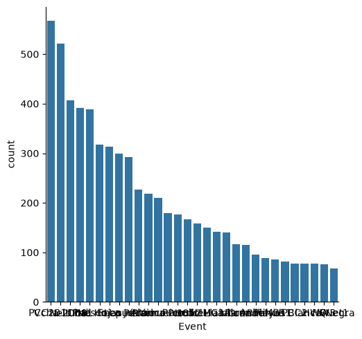
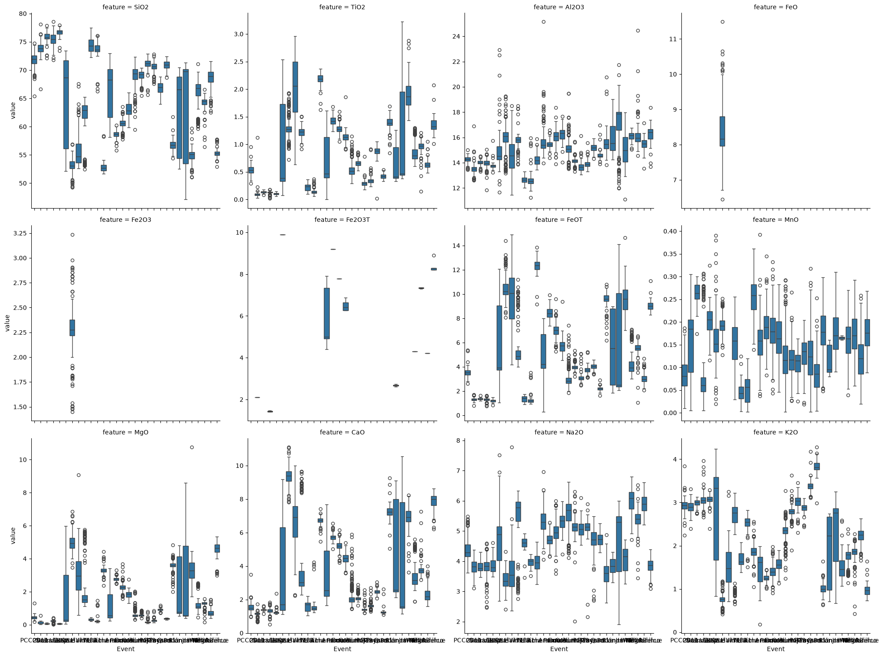

# Exploratory data analysis — volcanic geochemistry

## Dataset at a glance

<iframe src="data_analysis_train.html" width="100%" height="640"></iframe>

<iframe src="data_analysis_test.html" width="100%" height="640"></iframe>

## Modelling implications

- **The target is `Event`: the eruption that produced a sample.** The training
  table has 6220 rows and 95 columns (71 float, 24 string); the test table has
  839 rows with 73 float and 22 string columns. All 6220 training rows carry an
  `Event` label, with 30 classes. `Volcano`, the source edifice and a coarser
  label, is left for a separate later experiment.
- **The target is strongly imbalanced.** `Event` runs from 567 rows (PCC2011)
  and 521 (Vcha-2008) down to 67 (Quet1), about 8.5:1. Accuracy alone would be
  misleading; a per-class or macro-averaged metric and a majority-class
  baseline are the relevant comparisons.

  

- **The chemistry separates the sources, and the strongest signal is silica.**
  Of 45 chemistry columns, the raw major oxides `SiO2`, `K2O`, `MgO`, `FeOT`
  and `Al2O3` all return p ≈ 0 against the target, and the trace elements and
  ratios follow (`Zr` p = 2.7e-231, `La_Yb` p = 2.4e-208, `Rb` p = 3.8e-202).
  The isotope ratio `Sr87_Sr86` is the exception: p = 0.064, so it is only
  marginally informative.
- **Six major oxides carry much of the structure.** A pairplot of the six
  best-covered chemistry columns (`SiO2`, `CaO`, `K2O`, `Na2O`, `Al2O3`,
  `TiO2`) colours the sources two at a time.

  

  The same six columns dominate the PCA projection of all 45 chemistry
  columns: two components retain 52.7% of the variance (PC1 37.9%, PC2 14.8%).

  

- **A first read of the chemistry against the 30 labels.**

  

- **Major oxides separate most sources, but the trace block is thin.** The
  closest pairs in standardised major-oxide space are Michinmahuida and
  Quetrupillán (distance 1.03), Chaitén and Reclus (1.06), Monte Burney and
  Reclus (1.21), and Puyehue-Cordón Caulle and Quetrupillán (1.31). Trace
  elements exist for only 26 columns at about 20% coverage, and three
  volcanoes — Huanquihue Group, Quetrupillán and Villarrica — have no trace
  data at all, so the trace block can only arbitrate 45 of the 78 volcano
  pairs.

  

- **The major oxides are not independent of silica.** Against SiO2 the other
  oxides follow the differentiation trends the literature reports, so several
  columns carry overlapping information.

  

  

- **Replicate noise is small next to source differences.** Among the 222
  samples that were analysed more than once, the between-source variance is
  25.7× the within-sample variance for `FeOT`, 25.4× for `SiO2`, 19.1× for
  `Zr_Nb`, 17.5× for `CaO` and 15.2× for `TiO2`. This is what makes source
  attribution feasible on this table, and it also sets the noise ceiling a
  model has to beat.
- **No column is dominated by a reporting floor.** The largest single-value
  share is 11.1% for `Sr87_Sr86`, which has only 9 values; among the
  well-populated trace columns the repeated-value share reaches 34.2% (`Tb`)
  while no single value exceeds 2%. That pattern is consistent with rounding
  at a few significant figures rather than censoring.
- **Technique and source are confounded.** Median `TiO2` is 0.70 under EMP
  but 1.87 under LA-ICP-MS, and median `Dy` is 5.69 against 3.82. The
  technique split is itself very uneven — EMP covers 4790 rows across all 13
  volcanoes, LA-ICP-MS 1092 rows across 7 — so an element that differs by
  technique may only be showing which sources that technique sampled.
- **Geographic distance barely predicts compositional distance.** Across all
  78 volcano pairs the Spearman correlation between great-circle distance and
  major-oxide distance is 0.215, and across the 45 pairs with trace data it is
  0.100. The closest pair geographically, Quetrupillán and Villarrica at
  13.6 km, is 4.29 apart on majors.
- **Rows are far from independent.** Mocho-Choshuenco contributes 1685 rows
  from only 90 distinct `SampleID` values; a sample is measured a median of 8
  times, up to 70. A random row split would put the same sample on both sides
  of the evaluation.
- **The shipped split is already grouped by sample.** Train has 455 distinct
  `SampleID` values and test has 118, with zero shared keys, while all 30
  events appear on both sides. The test set therefore measures unseen
  *analyses of known eruptions*, not unseen eruptions.
- **Size and age columns behave as event constants, and the leakage check
  flags them.** 69 flags come out of the class-conditional null-rate test;
  `HistoricalAge` is present only for `1852 Llaima`, `PCC2011` and
  `Vcha-2008`, and `Magnitude`, `VEI`, `Location`, `SectionID` and
  `SubSectionID` each have very different null rates across the 30 events.
  `VEI` is missing for 59.8% of rows overall and `Magnitude` for 46.2%.
  `RadiocarbonAge` is entirely empty and `Ar40Ar39_Age` has two rows.
- **Analytical provenance leaks the source.** `Authors` and `DOI` have 25
  values each, 18 of which occur for exactly one volcano, covering 60.9% of
  rows; `MeasurementRun` has 34 of 52 values confined to one volcano (27.7%
  of rows). These columns describe how a sample was measured, not what it is.
- **Two arithmetic identities hold in the chemistry block.** `Total` equals
  the sum of the major oxides to a median absolute gap of 1.4e-14 (the
  maximum gap, 14.7, comes from rows with partially missing oxides), and each
  `*_normalized` column equals `oxide / Total × 100` to about 3e-10. They are
  deterministic duplicates, so they are excluded from the 45 modelling
  columns.
- **The coordinates are clean and regional.** `Latitude` spans -53.75 to
  -38.7 and `Longitude` -75.68 to -68.7, both with zero missing values and no
  out-of-range points — the southern Andes. A model trained here will not
  transfer to another arc.
- **Duplicates: zero** exact duplicate rows in either table.

## Open questions

- **Is the shipped split the evaluation we want?** It already separates
  samples but keeps every event in training. Reporting on it measures new
  analyses of known eruptions; a model that must generalise to a new eruption
  needs a grouped split instead.
- **Do the provenance columns belong in the model at all?** `Authors`, `DOI`
  and `MeasurementRun` would have to be excluded or grouped rather than
  encoded, because they would let a model read the answer.
- **Should the oxide block be transformed?** Major-element data are
  compositional, and the Harker views show the oxides are mutually dependent,
  so a log-ratio representation is the candidate preprocessing before any
  linear or distance-based model.
- **How should the 30 classes be scored?** With 8.5:1 imbalance and several
  rare events, a per-class view is needed next to any overall number.
- **What would a new sample look like?** A model that uses `Authors`, `DOI`,
  `Flag` or event-level size and age attributes could not score an
  unlabelled sample, since those fields are filled in during curation.
